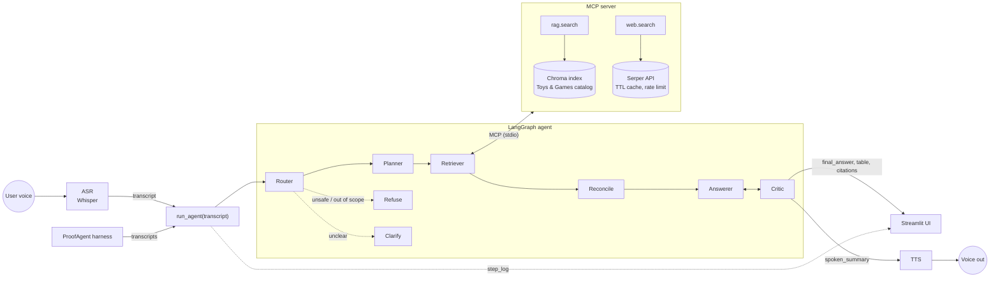

# System architecture

**Owner:** Devanshu · **Issue:** #30 · Used in the root README and the slides.

| Stage | Component | Owner | Code |
|-------|-----------|-------|------|
| Voice in / out, UI | Whisper ASR, TTS, Streamlit | Alekhya | `feature/ui` (planned) |
| Orchestration | LangGraph: Router, Planner, Retriever, Reconcile | Devanshu | [agent/](../agent/) |
| Answer quality | Answerer, Critic, guardrails | Beste | [agent/nodes/answerer.py](../agent/nodes/answerer.py), [agent/nodes/critic.py](../agent/nodes/critic.py) |
| Tools | MCP server: `rag.search`, `web.search` | Juan | [mcp_server/](../mcp_server/) |
| Private catalog | Preprocessing, Chroma index, `rag_search()` | Akshaj | [rag/](../rag/) |
| Evaluation | ProofAgent scenarios and scorecard | Beste | `feature/eval` |

Details of the graph: [components/langgraph.md](components/langgraph.md).
