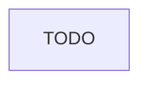

# LangGraph architecture

**Owner:** Devanshu · **Branch:** `feature/graph` · **Status:** todo
**Code:** TODO (graph, nodes) · **Contract:** [../../contracts/state.py](../../contracts/state.py)

## 1. Overview
<!-- One paragraph + a Mermaid diagram of nodes and edges, including the Answerer ⇄ Critic loop and conditional edges (e.g. clarification, safety refusal). -->

## 2. Nodes
| Node | Responsibility | Reads (`AgentState`) | Writes | Prompt | LLM / tools |
|------|----------------|----------------------|--------|--------|-------------|
| `router` | TODO | | | `prompts/router_system.md` | |
| `planner` | TODO | | | `prompts/planner_system.md` | |
| `retriever` | TODO | | | `prompts/retriever_tools.md` | `rag.search`, `web.search` |
| `answerer` | TODO | | | `prompts/answerer_system.md` | |
| `critic` | TODO | | | `prompts/critic_system.md` | |

## 3. State
<!-- Don't copy state.py. Explain how data flows through key fields and the append-only fields (step_log, errors). -->
TODO

## 4. Control flow
<!-- Routing conditions, when web.search is used, RAG vs web reconciliation, Critic revision limit (MAX_CRITIC_REVISIONS), failure paths. -->
TODO

## 5. Model configuration
<!-- How provider/model are chosen (config, env vars), per-node overrides. Model-agnostic requirement. -->
TODO

## 6. Observability
<!-- step_log, how the UI and ProofAgent consume it, any tracing. -->
TODO

## 7. Decisions, limitations, and known issues
TODO
