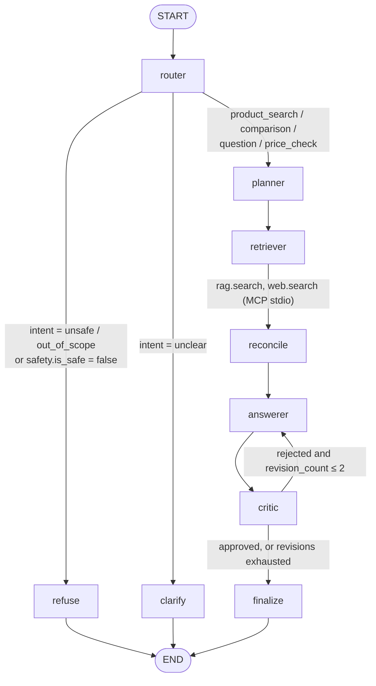

# LangGraph architecture

**Owner:** Devanshu · **Branch:** `feature/graph` · **Status:** draft
**Code:** [agent/](../../agent/) (graph in [agent/graph.py](../../agent/graph.py), entry point [agent/run.py](../../agent/run.py)) · **Contract:** [../../contracts/state.py](../../contracts/state.py)
**System diagram:** [../architecture.md](../architecture.md)

## 1. Overview

One spoken request becomes one graph run. The Router classifies the request and stops early for unsafe,
off-topic or vague requests. Otherwise the Planner chooses the tools, the Retriever calls them through the MCP server, Reconcile
merges catalog and live results, and the Answerer and Critic loop until the answer is grounded or the revision limit is hit.



LangGraph basics: a `StateGraph` over the `AgentState` TypedDict. Each node is a function that returns only the keys
it changed. LangGraph merges that into the state; `step_log` and `errors` are declared with an `operator.add` reducer,
so they append. Conditional edges are small functions of the state ([agent/graph.py](../../agent/graph.py)).

## 2. Nodes

| Node | Responsibility | Reads (`AgentState`) | Writes | Prompt | LLM / tools |
|------|----------------|----------------------|--------|--------|-------------|
| `router` | Intent, constraints, safety verdict, clarifying question | `transcript` | `intent`, `constraints`, `safety`, `clarification_question` | [system.md](../../prompts/system.md) + [router_system.md](../../prompts/router_system.md) + [guardrails.md](../../prompts/guardrails.md) | LLM (structured output) |
| `refuse` | Fixed guardrail response | `intent`, `safety` | `final_answer`, `spoken_summary` (+ empty table/citations) | templates parsed from [guardrails.md](../../prompts/guardrails.md), see [refusal.md](../../prompts/refusal.md) | none |
| `clarify` | Ask one clarifying question | `clarification_question` | same as `refuse` | (question comes from the Router) | none |
| `planner` | Tools (RAG / web), search text, filters, comparison criteria | `transcript`, `intent`, `constraints` | `plan` | [planner_system.md](../../prompts/planner_system.md) | LLM (structured output) |
| `retriever` | Execute the plan through MCP | `plan` | `rag_results`, `web_results`, `errors` | policy: [retriever_tools.md](../../prompts/retriever_tools.md) | `rag.search`, `web.search` |
| `reconcile` | Match catalog ↔ live, flag price conflicts, choose price | `rag_results`, `web_results`, `constraints`, `intent` | `reconciled` | policy: [retriever_tools.md](../../prompts/retriever_tools.md) | none |
| `answerer` | **Stub** → Beste (#46): top 3, citations, spoken summary | all of the above, `critic` | `draft_answer`, `final_answer`, `comparison_table`, `citations`, `spoken_summary` | `answerer_system.md` (Beste) | stub: none |
| `critic` | **Stub** → Beste (#47): grounding, budget, age checks | answer fields | `critic`, `revision_count` | `critic_system.md` (Beste) | stub: none |
| `finalize` | Close the run; record an error if never approved | `critic`, `revision_count` | `errors` (if not approved) | — | none |

Every node appends one `step_log` entry (`log_step(node, summary, **details)`).

## 3. State

The contract is [contracts/state.py](../../contracts/state.py); this is how data moves through it:

- **Input:** `transcript` (plus `session_id`, `asr_segments` from the UI).
- **Router → Planner:** `constraints` holds the hard constraints (`budget_max`, `child_age_years`, `exclude_features`, ...).
  The Planner copies them into `plan.rag_filters` **in code**, so an LLM can't drop or invent a budget or age filter.
- **Retriever → Reconcile:** `rag_results` (`RagProduct` dicts, each with a `doc_id`) and `web_results` (`WebResult`
  dicts, each with a `url`). Validated with the Pydantic models in [contracts/tool_schemas.py](../../contracts/tool_schemas.py).
- **Reconcile → Answerer:** `reconciled` (one `ReconciledProduct` per catalog product: `chosen_price`, `price_source`,
  `price_conflict`, `note`).
- **Output:** `final_answer` (with `[n]` markers), `comparison_table`, `citations` (`[n]` → `doc_id` or `url`),
  `spoken_summary` (≤ 40 words, no markers).
- **Append-only:** `step_log` (one entry per node; tool calls are in the Retriever entry's `details.tool_calls` with
  args, result count, latency, error), and `errors` (tool failures, LLM failures, timeouts).

## 4. Control flow

- **Routing after the Router:** `unsafe`, `out_of_scope`, or `safety.is_safe = false` → `refuse`; `unclear` → `clarify`;
  everything else → `planner`. Code overrides: an unsafe verdict always forces `intent = "unsafe"`; `unclear` with a product
  type, brand or age becomes `product_search`; an empty transcript asks the user to repeat without calling the LLM.
- **When `web.search` is used:** `plan.use_web` is true when the Planner LLM asks for it, and is **forced** when
  `constraints.wants_current_info` (the Router, plus a keyword backup in config such as "current", "in stock",
  "latest") or `intent = price_check`. With web on, the Retriever runs one live lookup per top-3 catalog product so
  results can be matched. If `rag.search` returns nothing, it falls back to one `web.search` and logs the reason.
- **Reconciliation:** SKU → brand + title → title similarity on *distinctive* words. A conflict is a price gap > 10%
  (`PRICE_CONFLICT_THRESHOLD`). The live price is chosen when the user asked for current info, otherwise the catalog
  price; the `note` explains the choice and the conflict. The answer leaves out products whose chosen price is over budget.
- **Critic loop:** the Critic increments `revision_count` on rejection; the graph returns to the Answerer while
  `revision_count ≤ MAX_CRITIC_REVISIONS` (2). So there are at most 2 rewrites, then `finalize` returns the last
  draft and adds an error.
- **Failure paths:** LLM failure in the Router → clarifying "please rephrase"; in the Planner → a catalog-only fallback
  plan; MCP server down or a tool error → `errors`, the graph continues; overall timeout (`RUN_TIMEOUT_S`, 240 s) → partial
  state. `run_agent()` never raises and always returns a speakable `final_answer`.

## 5. Model configuration

- One helper, [agent/llm.py](../../agent/llm.py), builds every node's model with LangChain `init_chat_model(model,
  model_provider=...)`. Settings: [config/llm.py](../../config/llm.py).
- Defaults: `openai` / `gpt-4o-mini`, temperature 0.2. Per-node `max_tokens` (Router/Planner 800, spoken summary 220).
- Override with env vars (not `.env`, which is secrets only): `LLM_PROVIDER`, `LLM_MODEL`, `LLM_TEMPERATURE`,
  `LLM_MAX_TOKENS_<NODE>`, `LLM_MODEL_<NODE>`.
  ```bash
  LLM_PROVIDER=anthropic uv run python -m agent "board game under $30"   # uses claude-haiku-5-5 + ANTHROPIC_API_KEY
  LLM_PROVIDER=fake uv run pytest                                        # offline, deterministic
  ```
- Structured output goes through the provider's **tool/function calling** (`with_structured_output(method="function_calling")`),
  with one retry if the reply doesn't validate.
- The provider and model used are logged in the Router and Planner `step_log` details.

## 6. Entry point and observability

```python
from agent import run_agent

state = run_agent(transcript, session_id=None, asr_segments=None, on_step=None)
```

- Synchronous; returns the final `AgentState` as a JSON-serializable dict; never raises for agent failures.
- `on_step(entry)` is called in the caller's thread as each node finishes (live step log in Streamlit).
- The MCP server subprocess is started once and reused across calls (the real one loads an embedding model).
- CLI: `uv run python -m agent "..."`, `uv run doit agent_demo`, `uv run doit agent_ask -q "..."`.

## 7. Real components and mocks

| Component | Default | Mock / swap |
|-----------|---------|-------------|
| MCP server | Juan's [mcp_server/](../../mcp_server/) (`MCP_SERVER_ARGS="-m mcp_server"` in [config/graph.py](../../config/graph.py)), backed by Akshaj's `rag_search()` and Serper | `MCP_SERVER_ARGS="-m mocks.mcp_server"` runs [mocks/mcp_server.py](../../mocks/mcp_server.py) on 12 fake products ([mocks/fake_catalog.py](../../mocks/fake_catalog.py)); the offline tests always use it. |
| Server start | waits up to `MCP_STARTUP_TIMEOUT_S` (180 s): the server loads the embedding model and reranker before the handshake (~12 s warm, ~70 s on a fresh venv) | first tool call: `MCP_FIRST_CALL_TIMEOUT_S` (120 s); later calls: `MCP_TOOL_TIMEOUT_S` (30 s) |
| Answerer / Critic | stub: [agent/nodes/answerer_stub.py](../../agent/nodes/answerer_stub.py) | One import line in [agent/graph.py](../../agent/graph.py). The interface they must match is at the top of the stub file. |

## 8. Decisions, limitations, and known issues

- **Deterministic Retriever.** The Planner (LLM) decides; the Retriever executes. This keeps tool calls reproducible and
  avoids exposing dotted tool names to LLM function calling (#20).
- **Refusals are fixed text** from `guardrails.md`, not generated, so safety responses can't drift.
- **`mcp<2` pinned.** mcp 2.x renamed FastMCP and changed the server API; most docs and examples still target 1.x.
- **Free-text category isn't a filter.** `constraints.category` ("board game") goes into the search text, because
  `RagSearchInput.category` is an exact catalog category.
- The fake LLM (`LLM_PROVIDER=fake`) is a keyword stand-in for tests only; it isn't what ProofAgent evaluates.
